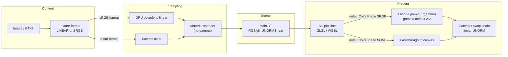

# Color output

How colour is handled in ris-framework-ts today (branch `0.4.0` working tree).

## Goals

- Work in **linear** light in the main render target and in material shaders.
- **Material shaders never convert gamma** (no encode/decode in unlit / lit / sprite materials).
- Encode to sRGB **once**, at the end, in the main-render-target **blit** when the renderer asks for it.
- Keep texture colour spaces explicit per texture (`ColorSpace` / format), not as a global shader gamma.

## Output color space

`renderer.outputColorSpace` (`OutputColorSpace` in `src/api/rendering/enums.ts`):

| Value | Default? | Behaviour |
|-------|----------|-----------|
| `NONE` | **yes** | Blit passes sampled values through (no encode). |
| `SRGB` | | Blit encodes linear → display in the shader. |

Configured via `IFrameworkConfiguration.outputColorSpace` and at runtime with `renderer.outputColorSpace`. The setter updates `IMainRenderTargetRenderPipeline.outputColorSpace` and does **not** recreate the main render target.

`preferredTextureFormat` still follows `outputColorSpace` (`RGBA8_UNORM_SRGB` when `SRGB`, else `RGBA8_UNORM`) for **content loading** (images / factories). The main render target itself stays linear (see below).

## Main render target

Both WebGL and WebGPU create the main RT as **`TextureFormat.RGBA8_UNORM`** (linear). Scene draws write linear values into it. Encoding for the screen is **not** done by attaching an sRGB view of the main RT.

WebGPU mesh pipelines target `RGBA8_UNORM` for that reason (they no longer rebuild against `preferredTextureFormat`).

## Blit (final encode)

Pipelines: `WebGlMainRenderTargetRenderPipeline` (`shaders/glsl/main_render_target_fs.glsl`) and `WebGpuMainRenderTargetRenderPipeline` (`shaders/wgsl/main_frame_buffer.wgsl`).

Shared interface: `IMainRenderTargetRenderPipeline`

| Property | Default | Role |
|----------|---------|------|
| `outputColorSpace` | `NONE` | When `SRGB`, the fragment shader encodes; when `NONE`, passthrough. |
| `gamma` | **2.2** | Uniform `u_gamma` / `fragmentData.gamma`. Currently used as `pow(c, 1 / gamma)` for the encode. |
| `flipY` | WebGL `true`, WebGPU `false` | Vertical flip for the default framebuffer origin (WebGL bottom-left). |

Uniform buffer (std140, 16 bytes): `[flipY, colorConversion, gamma, pad]` — floats only (`0`/`1` for booleans).

WebGL always encodes in the blit when `SRGB` because the **canvas / default framebuffer is never sRGB**. WebGPU uses the same blit encode path so both backends stay consistent (main RT stays linear; no sRGB swap-chain / view encode for output).

## Textures and sampling

- Per-texture **`ColorSpace`** (`LINEAR` / `SRGB`) and format (`RGBA8_UNORM` vs `RGBA8_UNORM_SRGB`, plus compressed `*_SRGB` variants).
- An **sRGB format** texture is decoded to linear by the GPU when sampled.
- **KTX2**: follows the file’s transfer function (OETF) unless an explicit `colorSpace` / format override is set on the descriptor.
- Factories / loaders use `preferredTextureFormat` (and thus `outputColorSpace`) when no explicit format is given.

## Texture views

`IGraphicsDeviceFeatures.supportsTextureView`:

| Backend | Value | Behaviour |
|---------|-------|-----------|
| WebGPU | `true` | Native `GPUTexture.createView`; views cached on `ATexture2D`. |
| WebGL2 | `false` | `ITextureDescriptor.viewFormats` (non-empty) throws in `ATexture2D`’s constructor; `getTextureView` / `defaultTextureView` throw. Attach `RenderPassColorAttachment.texture` only. |

`ARenderer` sets `attachment.view` only when `graphicsDevice.features.supportsTextureView` is true (default linear view of the main RT on WebGPU).

## Flow

## Known gaps

- **CPU colours** (clear colour, material colour uniforms, etc.) are **not** linearized — there is no `Color.toLinear()` (or similar) yet. If you feed 8-bit sRGB hex values into a linear RT with `outputColorSpace = SRGB`, highlights/lit results can look wrong until those values are converted on the CPU or authored as linear.
- Some texture creation paths still default **`COPY_DST`** in usage flags in ways that may be broader than needed; that is unrelated to colour but left as an outstanding cleanup.
- Blit encode is currently a **pure power** curve (`pow(c, 1/gamma)`), not the piecewise sRGB OETF (`c <= 0.0031308 ? 12.92*c : 1.055*pow(c, 1/2.4)-0.055`). Exact OETF can replace the power path later while keeping `gamma` for a custom mode.

## Key files

- `src/api/rendering/enums.ts` — `OutputColorSpace`, `ColorSpace`
- `src/core/rendering/ARenderer.ts` — main RT creation, `outputColorSpace` setter
- `src/api/rendering/render-pipelines/IMainRenderTargetRenderPipeline.ts`
- `shaders/glsl/main_render_target_fs.glsl`, `shaders/wgsl/main_frame_buffer.wgsl`
- `src/api/rendering/IGraphicsDeviceFeatures.ts` — `supportsTextureView`
- `src/core/rendering/texture/texture.ts` — `ATexture2D` view cache / viewFormats gate
