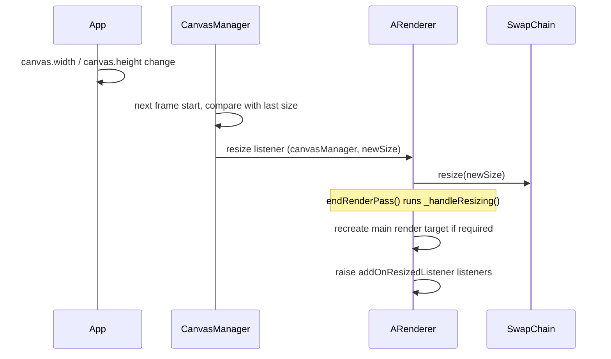

# Resizing

How a canvas size change reaches the swap chain and the main render target in ris-framework-ts (branch `0.4.0` working tree).

## Sizes involved

| Size | Owner | Meaning |
|------|-------|---------|
| Canvas size | `canvas.width` / `canvas.height` | Set by the application. The framework never changes it. |
| Swap chain size | `ISwapChain.backBufferSize` | The size the swap chain presents at. Changed by `ISwapChain.resize(size)`. |
| Back buffer size | `IRenderer.backBufferSize` | The size of the main render target (and its depth-stencil buffer) that scenes draw into. |

The main render target is blitted to the swap chain at the end of every frame, so the back buffer size and the swap chain size can differ.

## Flow



### 1. Canvas manager detects the change

`CanvasManager` checks `canvas.width` and `canvas.height` at the start of every frame, before the update listeners. When either differs from the last frame, it calls every listener added with `addOnResizeListener(listener)` with the canvas manager and the new size.

It reads the canvas attributes, not the CSS size, so it doesn't use `ResizeObserver`. To resize the output, set `canvas.width` and `canvas.height`.

### 2. Renderer resizes the swap chain

`ARenderer.initializeAsync()` adds a resize listener that calls `swapChain.resize(newSize)`. When `renderer.backBufferMatchesSwapChain` is `true`, it also copies the new swap chain size into `backBufferSize` and marks the main render target for a resize.

The swap chain always follows the canvas. Setting `backBufferSize` never resizes the swap chain.

- **WebGPU** (`WebGpuSwapChain`): stores the new size and drops the current canvas texture view, so the next frame gets a texture of the new size. A size with a zero dimension is ignored.
- **WebGL** (`WebGlSwapChain`): only stores the size. `WebGlRenderPass.beginPass()` uses it as the viewport when it draws to the default framebuffer.

### 3. Renderer resizes the main render target

The main render target is marked for a resize when:

- `renderer.backBufferSize` is set (only allowed while `backBufferMatchesSwapChain` is `false`), or
- the canvas is resized while `backBufferMatchesSwapChain` is `true`, or
- `backBufferMatchesSwapChain` is turned on, which takes the current swap chain size.

At the end of the frame, `endRenderPass()` calls `_handleResizing()` after the main pass ends and before the blit. If the main render target is marked, it recreates the main render target, the depth-stencil buffer, the blit pipeline and the main render pass at `backBufferSize`, then raises the listeners added with `renderer.addOnResizedListener(listener)`.

The old main render target and depth-stencil buffer were used by this frame's main pass, so they are released with `queueDispose()` after the frame is submitted (see [Disposing](disposing.md)). The old blit pipeline is disposed right away because the blit has not run yet.

### 4. Render passes use the new size

`WebGlRenderPass.beginPass()` sets the viewport to the first color attachment's texture size, or to `swapChain.backBufferSize` for the default framebuffer. On WebGPU the viewport follows the attachment size automatically.

## Example

```ts
const canvas = framework.canvasManager.canvas;

window.addEventListener("resize", () => {
    canvas.width = canvas.clientWidth * devicePixelRatio;
    canvas.height = canvas.clientHeight * devicePixelRatio;
    // The canvas manager picks this up at the start of the next frame.
});

framework.renderer.addOnResizedListener((_renderer, size) => {
    // The main render target was recreated at `size`. Update cameras or size-dependent targets here.
});
```

